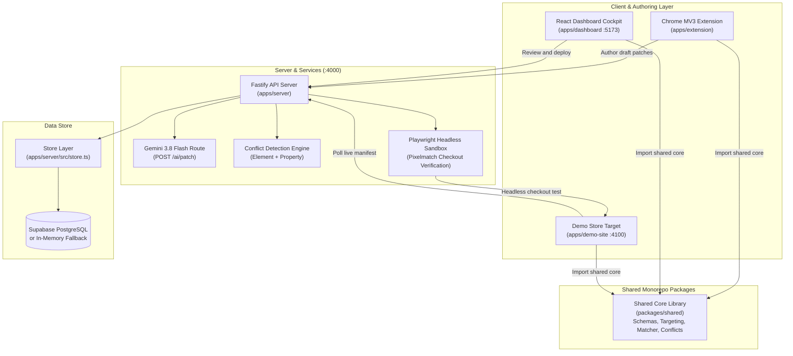

# Patchwork

> **Zero-rebuild live DOM hotfix engine for production web applications.**

[](https://github.com/Phoenix-huh/Sushi_college_round)
[](./LICENSE)
[](./apps/extension)
[](./apps/server/src/services/verifier.ts)
[](./apps/server/src/services/ai.ts)

Patchwork allows engineering teams to author, review, verify, and deploy UI and text hotfixes directly onto live web applications without waiting for full container rebuilds, CI/CD pipelines, or code redeployments.

---

## Architecture & Component Topology



---

## Features

- **Chrome Extension (MV3)**: Point-and-click DOM selector, visual property editor, and prompt-driven hotfix generation directly on live pages.
- **Natural Language Hotfixing**: `POST /ai/patch` uses Google's `gemini-3.8-flash` to transform plain text instructions into structured multi-anchor patch objects (with smart heuristic fallback).
- **Multi-Anchor Resilient Locator**: Anchors store 6 coordinates (`cssSelector`, `xpath`, `textContent`, `attributes`, `parentContext`, `siblingContext`).
- **Fuzzy Token Healer**: If site layout or classes change, computes token Jaccard similarity across id, class, name, text, and selector with common synonym normalization (`checkout`/`order`/`buy`, `cart`/`bag`, etc.). Heals targets when similarity $\ge 0.25$.
- **Element + Property Conflict Detection**: Analyzes concurrent teammate patches. Orthogonal changes to the same element (e.g. style vs. text) auto-merge; overlapping property edits trigger conflict flags.
- **Reviewer Approval Workflow**: Requires independent reviewer approval before compare-and-swap (CAS) merges; authors cannot approve their own patches.
- **Automated Playwright Verification**: Headless Chromium navigates checkout flows and performs pixelmatch screenshot comparison. If verification fails while a version is live, triggers automatic rollback.
- **Atomic Version Deployments & Rollbacks**: Each deploy or undeploy increments the version bundle. 1-click rollback reactivates the previous deployment, detected by the page runtime within 2 seconds.
- **Tamper Audit Trail**: Complete event history (`patch_created`, `patch_submitted`, `patch_approved`, `version_created`, `deployment_created`, `deployment_rolled_back`, etc.) persisted in Supabase or memory.

---

## Supported Types & Schema Facts

From [`packages/shared/src/schema.ts`](./packages/shared/src/schema.ts):

- **6 Anchor Fields**: `cssSelector`, `xpath`, `textContent`, `attributes`, `parentContext`, `siblingContext`
- **8 Change Types**: `text`, `style`, `visibility`, `script`, `attribute`, `remove`, `move`, `behavior`
- **9 Patch Statuses**: `draft`, `in_review`, `approved`, `live`, `conflicted`, `rejected`, `stale`, `broken`, `healed`

---

## The 7-Stage Lifecycle

```
[Author] ──> [Submit] ──> [Review] ──> [Deploy] ──> [Page Runtime] ──> [Verify] ──> [Undeploy / Rollback]
 (draft)    (conflict?)  (approved)    (live)       (polls live)     (Playwright)     (restores prior)
```

1. **Author** (`POST /patches` or `POST /ai/patch`): Generates a `draft` patch with multi-anchor coordinates.
2. **Submit & Conflict Check** (`POST /patches/:id/submit`): Checks for element + property collisions with other open patches or newer versions. Replaces base version with live version and marks `in_review` (or `conflicted` / `stale`).
3. **Review & Approve** (`POST /patches/:id/review`): Peer reviewer approves or rejects. Author self-approval is forbidden.
4. **Deploy** (`POST /patches/:id/merge` or `POST /deploy`): CAS merge validates base version, bundles ops into a new incremented Version record, and sets a new live Deployment.
5. **Page Runtime Delivery** (`GET /deployments/live`): Target page includes `patchwork-runtime.js` which polls every 2 seconds (`Cache-Control: no-store`) and applies changes in two passes.
6. **Post-Deploy Verification** (`POST /verify`): Playwright sandbox executes checkout journey; if it fails on live version, server initiates automatic rollback.
7. **Undeploy & Rollback** (`POST /patches/:id/undeploy` or `POST /rollback`): Undeploying creates a new version without that patch; rollback reactivates the previous deployment.

---

## Quickstart

### Prerequisites
- Node.js 18+
- npm 9+

### 1. Install Monorepo Dependencies
```bash
npm install
```

### 2. Configure Environment Variables
```bash
cp .env.example .env
```
Edit `.env`:
- `GEMINI_API_KEY`: Set your Google Gemini API key (required for AI natural-language patch creation).
- `SUPABASE_URL` / `SUPABASE_SERVICE_KEY`: Optional. If omitted, the server runs on an in-memory database store that resets on server restart.

### 3. Seed Demo Data
```bash
npm run seed
```

### 4. Run All Services Concurrently
```bash
npm run demo
```
This boots all three applications:
- **Demo Storefront**: [http://localhost:4100](http://localhost:4100) (TechMart e-commerce target app)
- **Fastify API Server**: [http://localhost:4000](http://localhost:4000) (Control plane, conflict engine & store)
- **Dashboard Cockpit**: [http://localhost:5173](http://localhost:5173) (Vite React control dashboard)

### 5. Build and Load the Chrome Extension (MV3)
```bash
npm run build -w apps/extension
```
To load into Google Chrome:
1. Open Chrome and navigate to `chrome://extensions/`.
2. Toggle **Developer mode** (top right) ON.
3. Click **Load unpacked** (top left).
4. Select the `apps/extension/dist` folder.

### 6. Run Tests & End-to-End Suites
```bash
# Unit & integration tests (232 tests)
npm test

# End-to-end flows
npm run e2e
npm run e2e:ext

# Type checking across monorepo
npm run typecheck
```

---

## Fastify API Reference

| Method | Endpoint | Description |
|---|---|---|
| `GET` | `/health` | Health check, server timestamp, Supabase connection status, and store mode |
| `GET` | `/sites` | List registered target sites and their active `live_version_id` |
| `POST` | `/sites` | Register a new target website |
| `GET` | `/profiles` | List development personas (`Developer` and `Reviewer`) |
| `GET` | `/patches` | List all patches (optional `?site_id=`) |
| `POST` | `/patches` | Create a new `draft` patch with multi-anchor locators |
| `GET` | `/patches/:id` | Get details for a single patch |
| `PUT` | `/patches/:id` | Update patch properties, change payload, or anchors |
| `PUT` | `/patches/:id/ops` | Update atomic operations array on a patch |
| `DELETE` | `/patches/:id` | Undeploy patch if live and remove from database |
| `POST` | `/patches/:id/submit` | Submit patch for review: runs conflict detection and auto-rebases base version |
| `GET` | `/patches/:id/conflicts` | List conflict records involving this patch |
| `POST` | `/patches/:id/review` | Submit review decision (`approved` or `rejected`; author cannot self-approve) |
| `POST` | `/patches/:id/merge` | CAS merge approved patch into a new live Version and Deployment |
| `POST` | `/patches/:id/deploy` | Deploy single patch (merges if approved, or deploys directly) |
| `POST` | `/patches/:id/undeploy` | Remove patch from live deployment by creating a new version with remaining patches |
| `POST` | `/patches/:id/healed` | Client runtime reports a successful fuzzy self-healing match with score |
| `GET` | `/conflicts` | List open conflicts and dynamically detected concurrent overlaps |
| `POST` | `/conflicts/:id/resolve` | Resolve conflict with choice (`a`, `b`, or custom value) |
| `GET` | `/versions` | List all historical Version bundles with parent links and ops snapshots |
| `GET` | `/deployments` | List all deployments with canary percentage and rollback timestamps |
| `GET` | `/deployments/live` | Active live deployment manifest consumed by the page runtime (`Cache-Control: no-store`) |
| `POST` | `/deploy` | Deploy an arbitrary array of `patch_ids` into a new Version and Deployment |
| `POST` | `/rollback` | Roll back current live deployment to the most recent earlier non-rolled-back deployment |
| `POST` | `/deployments/:id/activate` | Reactivate/redeploy an existing historical deployment by ID |
| `POST` | `/canary/error` | Record error on canary deployment; auto-rolls back if threshold ($\ge 3$) is reached |
| `POST` | `/verify` | Run Playwright + Pixelmatch checkout verification for `version_id`; auto-rolls back if live |
| `POST` | `/ai/patch` | Natural language patch generator via Gemini 3.8 Flash (`gemini-3.8-flash`) |
| `GET` | `/audit` | List full audit trail event logs |

---

## Known Limitations

To maintain architectural transparency:
1. **No Edge/CDN Invalidation**: Patchwork does not utilize Cloudflare Workers, Fastly VCL, or edge CDN lambdas. Patches are served by the Fastify server and pulled by the page runtime via client polling (`GET /deployments/live` with `Cache-Control: no-store`).
2. **No Cryptographic Hash Chaining**: The audit log does not use cryptographic block hashing, Merkle trees, or HMAC signing. Events are standard database rows storing UUIDs, timestamps, actor IDs, and JSON payloads.
3. **Deploy Pre-Gating**: Deployments are not pre-gated by Playwright verification. Deployments go live immediately (`verification_status: "pending"`). Verification is invoked asynchronously or on-demand; if verification fails on a live version, the server performs a reactive automatic rollback.
4. **Approval Enforcement Scope**: Strict reviewer approval (`patch.status === "approved"`) is enforced by `POST /patches/:id/merge`. However, `POST /deploy` and `POST /patches/:id/deploy` accept unapproved patches directly for rapid testing.
5. **Rollback Resolution**: There is no arbitrary "revert to version N" command. Rollbacks either restore the most recent prior deployment (`POST /rollback`) or activate an explicit historical deployment by ID (`POST /deployments/:id/activate`).
6. **Script Patch Irreversibility**: Changes of type `script` execute JavaScript and cannot be automatically undone by DOM reversion records. For security, `script` execution is disabled by default in content scripts.

---

## License

This project is licensed under the MIT License — see the [LICENSE](./LICENSE) file for details.

Copyright (c) 2026.
